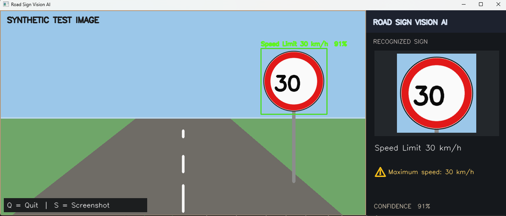

# Road Sign Vision AI 🚦

A small **Python + OpenCV computer vision** project for recognizing German traffic signs from a webcam, video, or image. Built as a junior-level portfolio project.

**Developed by Saman Farshad**

## Demo preview

The screenshot below shows the application detecting a 30 km/h sign in the included **synthetic test image**.



## What it does

1. Uses OpenCV color and shape filtering to find *possible* road signs.
2. Crops the candidate signs and classifies them using a pretrained **43-class GTSRB classifier**.
3. Draws a box around recognized signs in the camera image.
4. Shows the **actual cropped sign** on a right-hand panel with an English warning and confidence.
5. Allows screenshots (`S`) and supports image, video, and webcam input.

**Important:** This project recognizes ordinary circular speed-limit signs such as 30 km/h. A `Zone 30` area sign is a separate German sign, **not** a class in this model. The app never claims to detect Zone 30.

## Project structure

```text
Road-Sign-Vision-AI/
├── app.py               # Camera and display
├── detector.py          # OpenCV candidate detection + AI classification
├── sign_info.py         # GTSRB class names and English alerts
├── make_demo.py         # Generate a synthetic example road scene
├── assets/
│   ├── demo_road.png    # Synthetic image to test the pipeline
│   └── demo_preview.png # Screenshot of the synthetic demo
├── tests/
│   ├── test_detector.py
│   └── test_sign_info.py
├── requirements.txt
├── .gitignore
└── README.md
```

## Installation (Windows PowerShell, Python 3.11)

```powershell
py -3.11 -m venv .venv
.\.venv\Scripts\Activate.ps1
python -m pip install -r requirements.txt
```

The first use downloads the trained model from Hugging Face and requires an internet connection. The model file is **not embedded in this repository**. Subsequent use normally reuses the local Hugging Face cache.

## Run

Webcam:

```powershell
python app.py
```

Video:

```powershell
python app.py --source data/road_video.mp4
```

Test image (included):

```powershell
python app.py --source assets/demo_road.png
```

If the model misses a sign, try `--confidence 0.65`. Lower values may increase wrong predictions. For a slow laptop use `--scan-every 3`.

- `Q` or `Esc`: quit
- `S`: save screenshot in `outputs/`

## Tests

```powershell
python -m pip install pytest
python -m pytest -q
```

These tests check color candidate detection and label handling **without downloading the AI model**. End-to-end model predictions require separate real-world testing.

## Model credit and limitations

Classification model: **Fraunhofer IOSB — ConvNeXt V2 Atto fine-tuned on GTSRB (43 classes)**  
https://huggingface.co/FraunhoferIOSB/convnextv2-atto-1k-224-finetuned-gtsrb  
Model license: CC BY 4.0 (see model card); credit Fraunhofer IOSB and the original GTSRB dataset contributors.

OpenCV finds color/shape candidates; the classifier identifies their type. The classifier **does not itself localize signs** in full road scenes. Real-world results can be affected by lighting, blurred video, small distant signs, and false color matches. The included synthetic picture is a **pipeline test, not proof of model accuracy**.

**Educational only — not suitable for driving safety decisions or as a certified driver-assistance system.**

## Language

The application interface, sign labels, and warnings are in **English**.
No right-to-left text packages are required.
